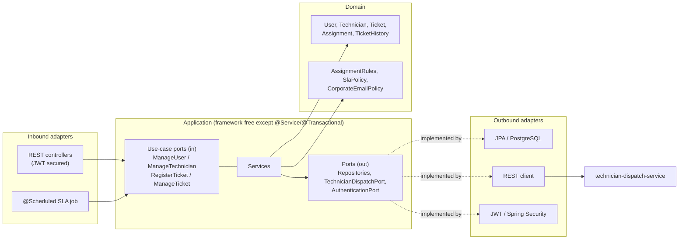
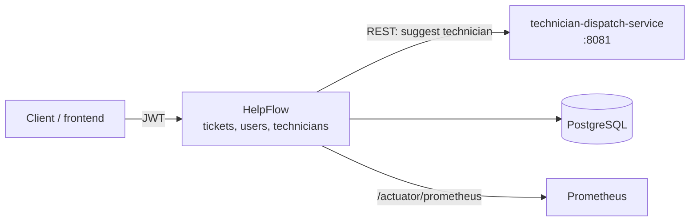
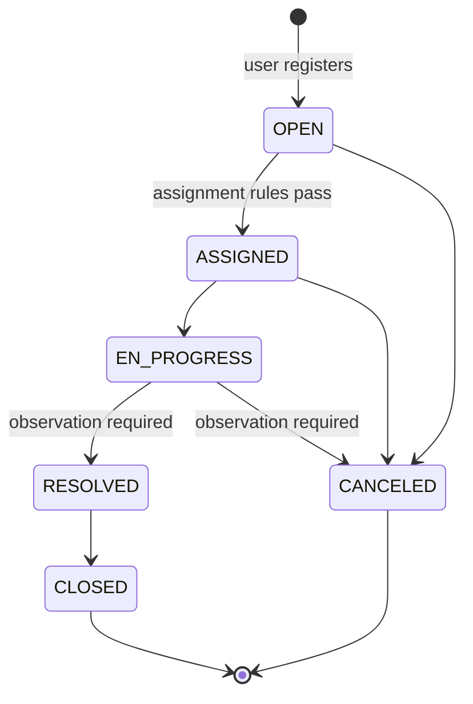
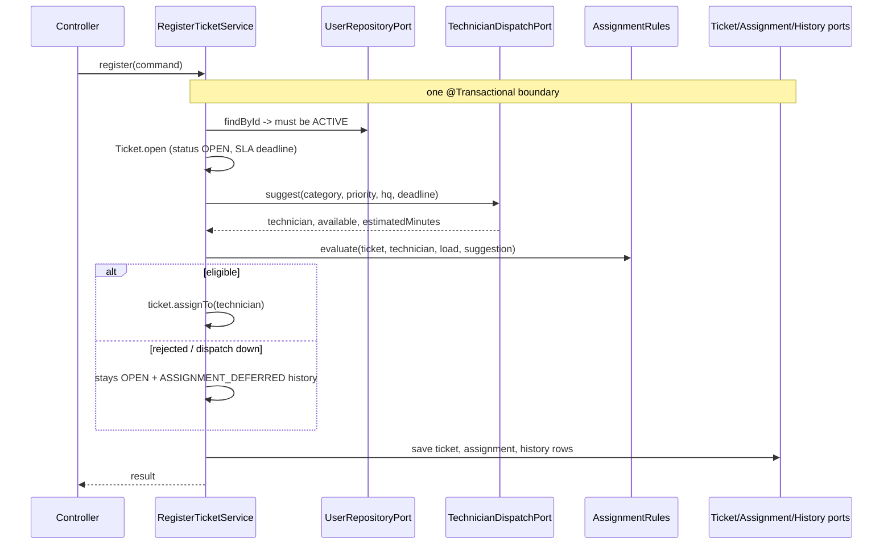
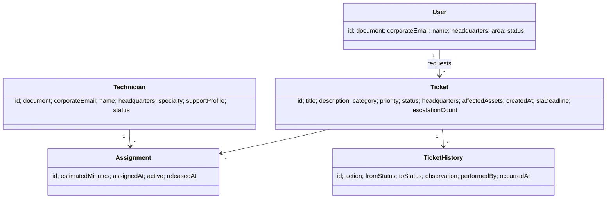

# HelpFlow – Part 1: analysis and design

Scope: domain model, hexagonal architecture, ticket lifecycle, ports and use cases.
Not included yet: REST controllers, JPA adapters, the dispatch REST adapter, JWT security (Part 2).

> Your brief mentions "salary", "membership date" and "ACTIVE affiliate to request credit". Those look pasted
> from another exercise (a credit union), so I left them out.

## 1. Hexagonal architecture



Dependency rule: `infrastructure -> application -> domain`. Never the other way.
That is why `DispatchSuggestion` lives in `domain.model` (the rules use it) and not next to the port.

Packages (matching your skeleton):

```
domain/model, domain/exception
application/port/in, application/port/out, application/service
infrastructure/config            BeanConfig
infrastructure/adapter/in/web    controllers + DTOs + MapStruct     (Part 2)
infrastructure/adapter/out/persistence   JPA entities + mappers    (Part 2)
infrastructure/adapter/out/dispatch      RestClient adapter         (Part 2)
infrastructure/security          JWT                                (Part 2)
```

## 2. Microservices



HelpFlow owns the data and the final decision. technician-dispatch-service only *suggests*
(technician, availability, estimated minutes). HelpFlow re-checks everything with `AssignmentRules`,
so a wrong or stale suggestion can never break a business rule.

## 3. Ticket lifecycle



SLA escalation is not a state change: while OPEN/ASSIGNED/EN_PROGRESS and past `slaDeadline`,
the priority goes up one level, the SLA restarts, and an `ESCALATED` history row is written.

SLA defaults (`SlaPolicy.defaults()`): CRITICAL 2h, HIGH 8h, MEDIUM 24h, LOW 72h.

## 4. Registration flow



Assignment rules (all in `AssignmentRules`): technician ACTIVE and available; specialty covers the category
(GENERALIST covers all); active load below the maximum (`helpflow.assignment.max-active-tickets`);
same headquarters unless the ticket is CRITICAL; CRITICAL needs LEVEL_2+; estimate must fit the SLA.
The headquarters and LEVEL_2 rules are my interpretation of "priority, headquarters and SLA" – adjust freely.

## 5. Model



## 6. Ports

| Port | Type | Purpose |
|---|---|---|
| `ManageUserUseCase`, `ManageTechnicianUseCase` | in | register, edit, activate/deactivate |
| `RegisterTicketUseCase` | in | register + initial assignment |
| `ManageTicketUseCase` | in | status changes with observations, SLA escalation |
| `User/Technician/Ticket/Assignment/TicketHistory RepositoryPort` | out | persistence |
| `TechnicianDispatchPort` | out | REST call to technician-dispatch-service |
| `AuthenticationPort` | out | login + current caller |

## 7. Decisions you should know about

- **IDs are UUIDs created in the domain**, so ticket, assignment and history can be built in memory and saved together; `save` returns `void`.
- **Uniqueness** is checked in the service (clear error) *and* enforced by DB `UNIQUE` constraints (the real guarantee under concurrency). Map `DataIntegrityViolationException` to 409 in Part 2.
- **Transaction + REST call**: the dispatch call happens inside the transaction, so a DB connection is held for up to the read timeout (5s in `application.yaml`). Fine to start; later, call dispatch first and open the transaction only to persist.
- **Dispatch failure never blocks registration**: ticket stays OPEN with a history row. You still need a retry/manual-assignment use case (Part 2).
- **Reopening RESOLVED tickets is not supported** (it would need to re-reserve technician load).
- Domain entities use Lombok `@Builder` for rehydration from the DB; creation goes through `register`/`open` factories that validate.

## 8. Config to add to `application.yaml`

```yaml
helpflow:
  corporate-email-domains: helpflow.com
  assignment:
    max-active-tickets: 5
```

## 9. Issues found in your skeleton

1. `compose.yaml` created DB `mydatabase` / user `myuser`, but `application.yaml` expects `HelpFlowDB` / `postgres` / `123456` – I aligned compose (fixed port mapping too).
2. `pom.xml`: MapStruct is a dependency but `mapstruct-processor` is missing from `annotationProcessorPaths` (only Lombok is there), so mappers will not be generated. When you add it, also add `lombok-mapstruct-binding`, and list Lombok first.
3. `application.yaml` logging uses `com.vianadanieldev.HelpFlow`; your package is `com.vianadanieldev.helpflow` (lower case), so that DEBUG level never applies.
4. The JWT secret has a default value in the file; fine for dev, but remove the default before deploying.
